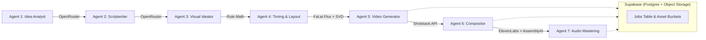

# Yuryvox — External API & Credentials Guide

> **Document Version:** 1.0  
> **Last Updated:** 2026-10-21  
> **Applies to:** Yuryvox Pipeline Agents 1–7, Orchestrator, and Storage

---

## 1. Overview & Architecture

Yuryvox is an **API-only agentic video generation pipeline**. It operates strictly without local GPUs, self-hosted models, or local media editing compute (no local FFmpeg). Hosted APIs handle model inference, image and video generation, speech synthesis, audio transcription, and media compositing.

The pipeline utilizes **6 external provider services** requiring **7 environment variables**:



---

## 2. API Credentials Quick Reference

| # | Provider | Environment Variable | Pipeline Stage / Agent | Purpose | Free Tier / Trial |
|---|---|---|---|---|---|
| **1** | **OpenRouter** | `OPENROUTER_API_KEY` | Agents 1, 2, 3 | Text research, scripting, and visual prompt generation | **Yes** (free open-source models available) |
| **2** | **Fal.ai** | `FAL_API_KEY` | Agent 5 | Image generation (Flux Schnell) & video clip generation (SVD) | **Yes** (trial credits on registration) |
| **3** | **Shotstack** | `SHOTSTACK_API_KEY` | Agent 6 | Cloud video stitching, transitions, kinetic text overlays, and audio mix | **Yes** (5–20 minutes free rendering per month) |
| **4** | **ElevenLabs** | `ELEVENLABS_API_KEY` | Agent 7 | High-fidelity AI narration / voiceover synthesis (TTS) | **Yes** (10,000 characters/month free) |
| **5** | **AssemblyAI** | `ASSEMBLYAI_API_KEY` | Agent 7 | Word-level speech-to-text alignment for timed captions (SRT/ASS) | **Yes** (~5 hours of free transcription/month) |
| **6** | **Supabase** | `SUPABASE_URL`<br>`SUPABASE_ANON_KEY`<br>`SUPABASE_SERVICE_ROLE_KEY` | Orchestrator & Storage | PostgreSQL state machine, job records, and asset storage buckets | **Yes** (500MB database + 1GB storage free) |

---

## 3. Provider Deep-Dive

### 3.1 OpenRouter
- **Website:** [https://openrouter.ai](https://openrouter.ai/)
- **Keys Required:** `OPENROUTER_API_KEY`
- **Assigned Agents:**
  - **Agent 1 (Idea Analyst):** Formulates research briefs, 3 angles, supported claims, and citations.
  - **Agent 2 (Scriptwriter):** Generates retention-focused explainer scripts (145 WPM calibration; 4–8s shot distribution).
  - **Agent 3 (Visual Ideator):** Develops scene visual direction, archival collage styling, and image/motion prompts.
- **Configured Models:**
  - `google/gemma-7b-it` (free)
  - `mistralai/mistral-7b-instruct` (free)
  - `mistralai/mixtral-8x7b-instruct` (free or ultra low-cost)
- **Cost:** ~$0.002 to $0.005 per complete video run.

---

### 3.2 Fal.ai
- **Website:** [https://fal.ai](https://fal.ai/)
- **Keys Required:** `FAL_API_KEY`
- **Assigned Agent:** **Agent 5 (Video Generator)**
- **Role in Pipeline:**
  - **Image Generation:** Uses `fal-ai/flux/schnell` to generate base visual collage stills (~$0.003 per image).
  - **Video Generation:** Uses `fal-ai/stable-video-diffusion` (SVD) to animate the still into a 4-second motion clip (~$0.04 per clip).
  - **Fallback:** If SVD fails or budget limit is hit, the still image is flagged for Ken Burns pan/zoom in Agent 6.
- **Cost:** ~$0.05 to $0.07 per scene. For a 90-second video (~15 scenes), estimated video generation cost is **~$0.75 – $1.05**.

---

### 3.3 Shotstack
- **Website:** [https://shotstack.io](https://shotstack.io/)
- **Keys Required:** `SHOTSTACK_API_KEY`
- **Assigned Agent:** **Agent 6 (Compositor & Transition Agent)**
- **Role in Pipeline:**
  - Cloud video rendering API that replaces local FFmpeg.
  - Takes video clips and fallback still images from Agent 5.
  - Applies transitions (crossfade, paper reveal, cuts).
  - Renders high-contrast on-screen typography overlays (Inter Bold) inside the 5% safe zone.
  - Mixes background music bed at -18 dB under voiceover.
  - Returns a hosted MP4 video URL and extracts a video poster thumbnail.
- **Cost:** Free tier includes 5–20 minutes/month. Paid plans start at ~$0.20/minute.

---

### 3.4 ElevenLabs
- **Website:** [https://elevenlabs.io](https://elevenlabs.io/)
- **Keys Required:** `ELEVENLABS_API_KEY`
- **Assigned Agent:** **Agent 7 (Audio Mastering Agent)**
- **Role in Pipeline:**
  - Generates realistic, natural spoken voiceover per scene.
  - Default voice: Configured in `config/presets/voice.json` (`voice_id: 21m00Tcm4TlvDq8ikWAM`, stability 0.45, similarity 0.8).
- **Cost:** Free tier covers 10,000 characters/month (covers ~2–3 short 90-second explainer videos). Paid tiers scale at ~$0.30/1,000 characters.

---

### 3.5 AssemblyAI
- **Website:** [https://www.assemblyai.com](https://www.assemblyai.com/)
- **Keys Required:** `ASSEMBLYAI_API_KEY`
- **Assigned Agent:** **Agent 7 (Audio Mastering Agent)**
- **Role in Pipeline:**
  - Transcribes the voiceover audio generated by ElevenLabs.
  - Provides exact word-level millisecond timestamps.
  - Pipeline chunks words into maximum 2 lines / 7 words per line and produces standard `.srt` and `.ass` subtitle files.
  - Calculates caption sync drift (warning triggered if drift > 100ms).
- **Cost:** Free tier covers ~5 hours of audio transcription each month.

---

### 3.6 Supabase
- **Website:** [https://supabase.com](https://supabase.com/)
- **Keys Required:** 
  - `SUPABASE_URL`
  - `SUPABASE_ANON_KEY`
  - `SUPABASE_SERVICE_ROLE_KEY` (Server-only; for storage uploads and backend operations)
- **Assigned Role:** **Orchestrator, Job Queue & Asset Storage**
- **Role in Pipeline:**
  - **PostgreSQL Database:** Tracks job state transitions (`PENDING`, `IDEA_ANALYST`, `SCRIPTWRITER`, `VISUAL_IDEATOR`, `TIMING_LAYOUT`, `VIDEO_GEN`, `COMPOSITOR`, `AUDIO_MASTERING`, `DONE`, `FAILED`).
  - **Storage Buckets:** Stores copies of assets so jobs don't rely on temporary provider CDN links:
    - `video-clips`: Generated Fal.ai clips.
    - `final-videos`: Master MP4 videos.
    - `voiceover`: WAV voiceover audio.
    - `captions`: `.srt` and `.ass` subtitle files.
    - `thumbnails`: Extracted poster frames.
- **Cost:** Free tier includes 500MB PostgreSQL database + 1GB storage.

---

## 4. Setup & Configuration Guide

### Step 1: Create `.env.local`
In the project root (`c:\Upwork\Yuryvox\`), copy `.env.example` to `.env.local`:

```bash
copy .env.example .env.local
```

### Step 2: Populate Keys
Open `.env.local` and paste your API keys:

```ini
# Text Model Inference (Agents 1-3)
OPENROUTER_API_KEY=sk-or-v1-xxxxxxxxxxxxxxxxxxxxxxxxxxxxxxxx

# Media Generation (Agent 5)
FAL_API_KEY=xxxxxxxx-xxxx-xxxx-xxxx-xxxxxxxxxxxx:xxxxxxxxxxxxxxxx

# Compositing & Video Stitching (Agent 6)
SHOTSTACK_API_KEY=xxxxxxxxxxxxxxxxxxxxxxxxxxxxxxxx

# Audio & Captions (Agent 7)
ELEVENLABS_API_KEY=sk_xxxxxxxxxxxxxxxxxxxxxxxxxxxxxxxx
ASSEMBLYAI_API_KEY=xxxxxxxxxxxxxxxxxxxxxxxxxxxxxxxx

# Database & Storage (Orchestrator)
SUPABASE_URL=https://your-project-id.supabase.co
SUPABASE_ANON_KEY=eyJhbGciOiJIUzI1NiIsInR5cCI6IkpXVCJ9...
SUPABASE_SERVICE_ROLE_KEY=eyJhbGciOiJIUzI1NiIsInR5cCI6IkpXVCJ9...

# Smoke Testing Flag
# Keep false during development to prevent accidental credit spend.
# Set to true only when testing live provider connections.
YURYVOX_SMOKE_LIVE=false
```

### Step 3: Verify Setup
Start the development server and check configuration:

```bash
npm run dev
```

1. Open [http://localhost:3000](http://localhost:3000) to view the **Credential Checklist**.
2. Call `GET http://localhost:3000/api/health` to confirm safe boolean presence detection.
3. Call `GET http://localhost:3000/api/smoke` to verify adapter readiness.

---

## 5. Mock Mode vs. Live Spend Architecture

> [!IMPORTANT]
> **You do NOT need active paid keys to develop, test, or run the web application.**

- **Mocks-First Design:** Every agent in `lib/agents/*.ts` has a deterministic mock generator (`forceMock: true` or automatic fallback when environment variables are unset).
- **Zero-Spend Development:** Running `npm test`, executing local unit suites, testing the orchestrator, and testing the frontend UI consumes **$0.00**.
- **Phase 12 Budget Gate:** Live, billable calls to Fal.ai, Shotstack, and ElevenLabs are strictly guarded until human operator review confirms budget limits and live rendering authorization.
